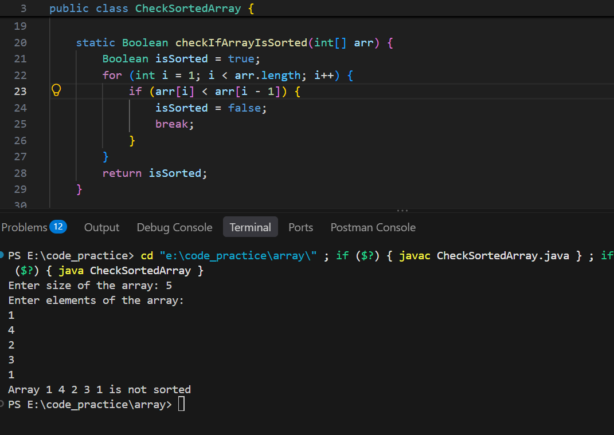

# Check Whether an Array Is Sorted(in ascending order) or Not

## Problem Statement

Write a program to check whether the given array is sorted in ascending
order or not.

## Algorithm

1.  **Start.**
2.  Take an array as input from the user.
3.  Initialize a Boolean variable `isSorted` with `true`.
4.  Iterate through the array from index `1` to `array.length`.
5.  Compare the current element with the previous element:
    -   If `array[i] < array[i - 1]`:
        -   Set `isSorted = false`.
        -   Break the loop.
6.  Print the result:
    -   If `isSorted` is `true`, print **"Array is sorted."**
    -   Otherwise, print **"Array is not sorted."**
7.  **Exit.**

## Algorithm Flow

-   **Input:** An array of elements.
-   **Process:** Compare each element with its previous element.
-   **Output:** Whether the array is sorted in ascending order.

## Screenshot



> Make sure the screenshot exists at `screenshot/chek_sorted_array.png`
> in the repository. Update the path if your filename or folder is
> different.

## Complexity Analysis

Let `n` be the number of elements in the array.

-   **Best-case time complexity:** `O(1)` --- the first comparison finds
    an out-of-order pair.
-   **Worst-case time complexity:** `O(n)` --- the entire array is
    checked.
-   **Space complexity:** `O(1)` --- only a Boolean variable is used.

## Examples

**Example 1**

Input:

``` text
[1, 2, 3, 4, 5]
```

Output:

``` text
Array is sorted.
```

**Example 2**

Input:

``` text
[1, 3, 2, 4, 5]
```

Output:

``` text
Array is not sorted.
```

## Note

This algorithm checks whether an array is sorted in ascending order.
Duplicate elements are allowed.
